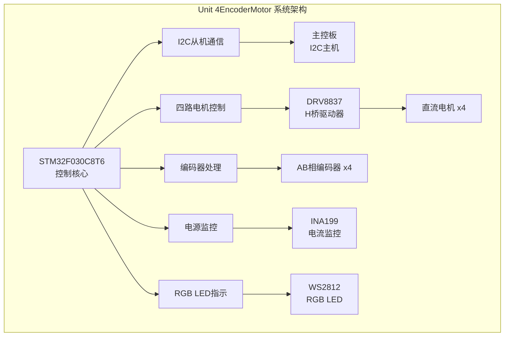
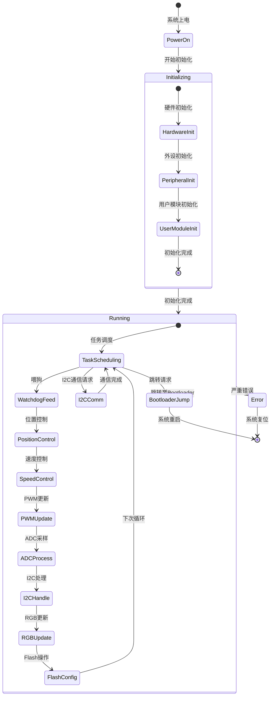
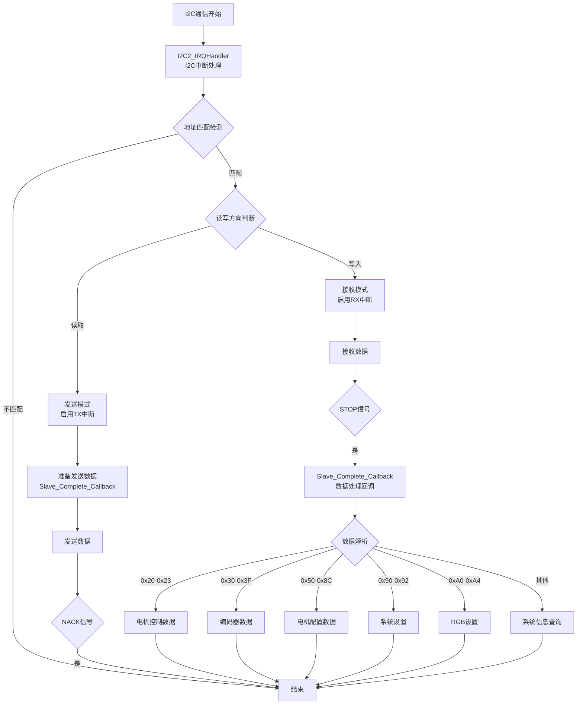
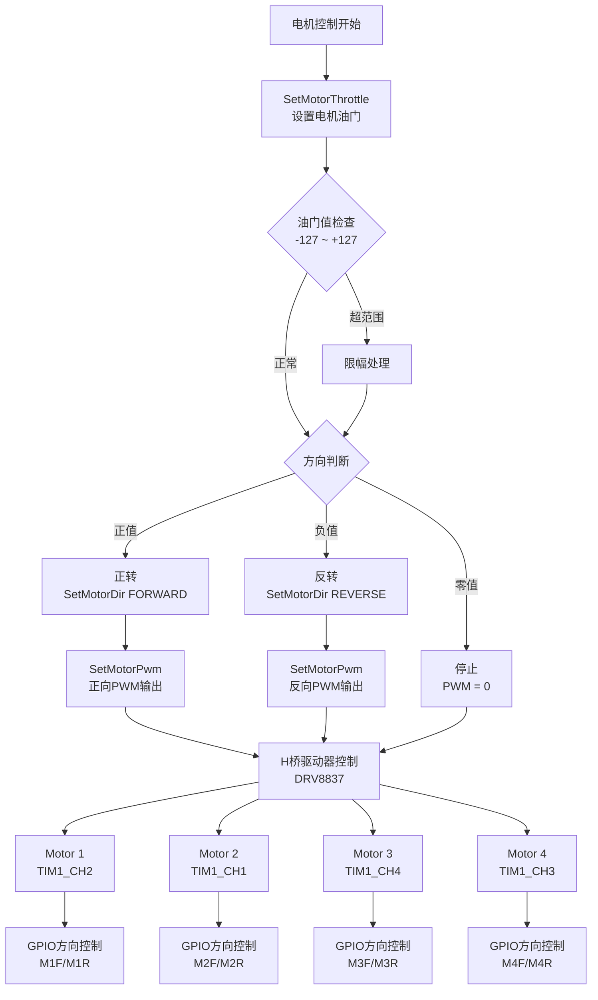
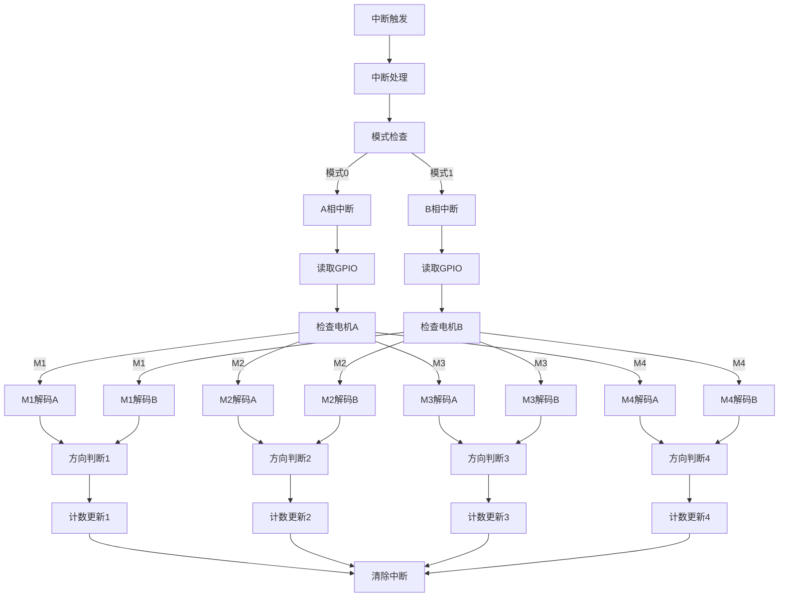
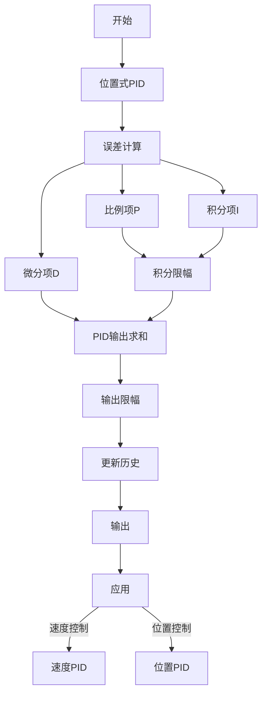
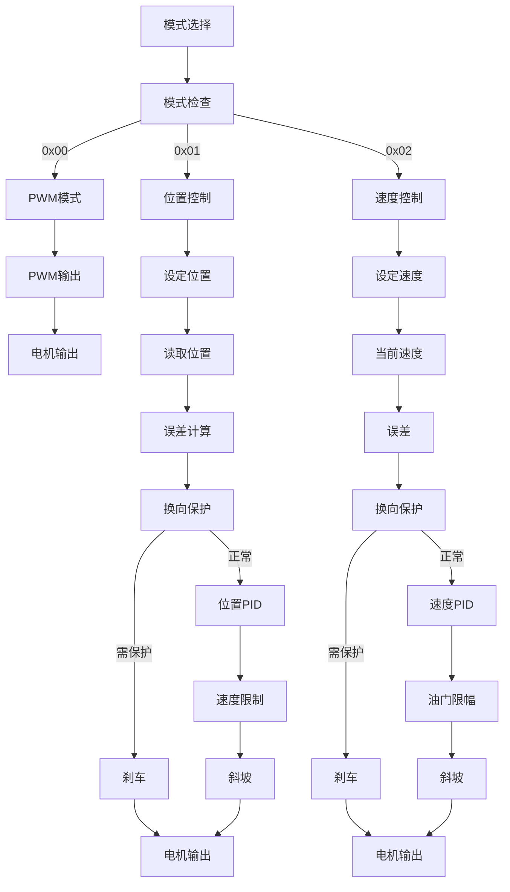
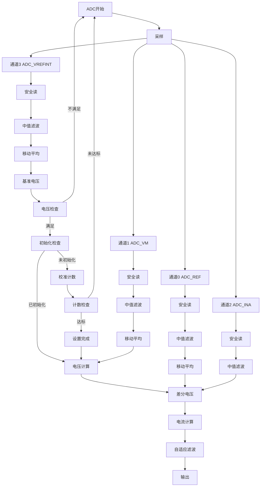
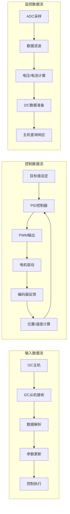

# Unit 4EncoderMotor Mermaid 流程图

查看方法：VsCode打开当前文件，右键选择“重新打开编辑器的方式”--> "MarkDown Editor"，即可查看。

## 系统总体架构图

## 系统状态机图

## I2C通信系统流程图

## 电机控制系统流程图

## 编码器处理系统流程图

## PID控制算法流程图

## 控制模式流程图

## 电源监控系统流程图

## 数据流向图

